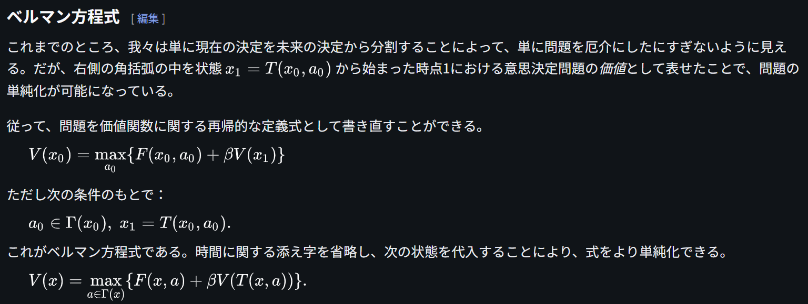

# Bellman Equation

文献:

https://ja.wikipedia.org/wiki/%E3%83%99%E3%83%AB%E3%83%9E%E3%83%B3%E6%96%B9%E7%A8%8B%E5%BC%8F

解説:

動的計画法に関する最適性の必要条件を表す方程式。競プロ文脈との主要な違いは、$\beta$ が 1 未満であること。将来の価値を割り引くことで、有限時間での最適化を行うためである。

現在の状態で得られる最大の価値 =「今得られる報酬」+「割り引いた将来の価値」が最大になるように行動を選んだ結果。

| 記号 | 意味 |
| --- | --- |
| $V(x)$ | 状態 $x$ における最適な将来価値（価値関数） |
| $\Gamma(x)$ | 状態 $x$ で選択可能な行動 $a$ の集合 |
| $F(x,a)$ | 状態 $x$ で行動 $a$ を取った際の即時報酬 |
| $\beta$ | 将来価値の割引係数（$0<\beta<1$） |
| $V(T(x,a))$ | 次の状態 $T(x,a)$ における最適な将来価値 (再帰的定義) |
