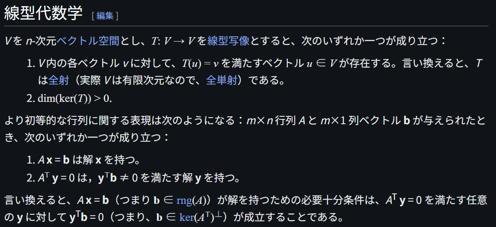
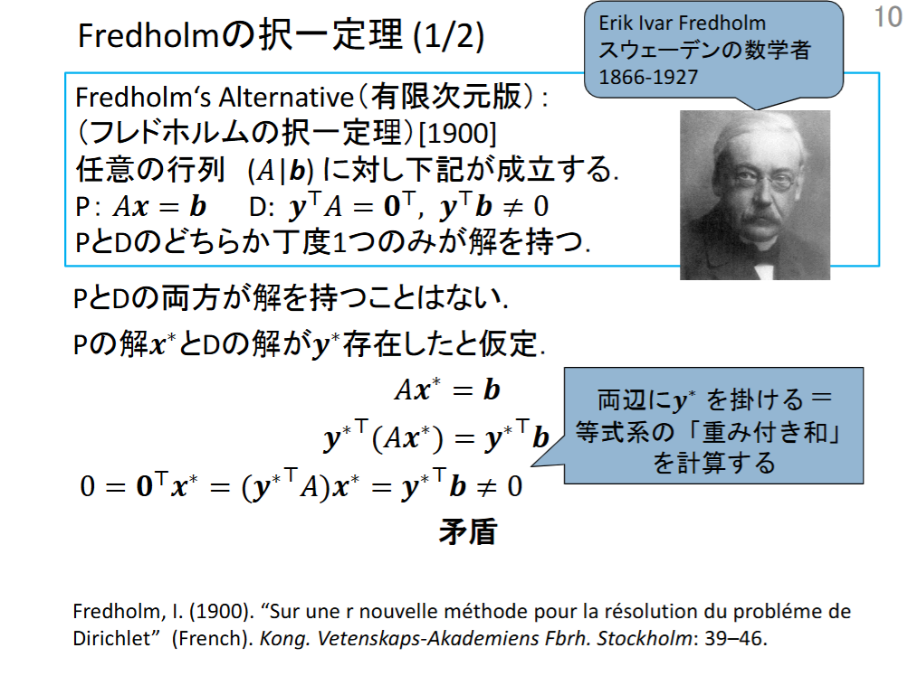

# Fredholm Alternative

文献:

https://en.wikipedia.org/wiki/Fredholm_alternative

https://www.ism.ac.jp/~mirai/sscoke/2026/

(松井先生の講義資料, 10ページ辺り)

<!--  -->

解説:

実行列 $A \in \mathbb{R}^{m \times n}$ と $b \in \mathbb{R}^m$ に対し、$P: A x = b$ か $D: y^\top A = 0^\top, y^\top b \neq 0$ のどちらか丁度1つのみが解を持つという定理。
まず、両方の解 $x^\ast, y^\ast$ が存在すると仮定すると、次のように矛盾が導かれる。

$$
\begin{equation*}
    0 = 0^\top x^\ast = (y^\ast)^\top A x^\ast = (y^\ast)^\top b \neq 0
\end{equation*}
$$

これで、両方が同時に解を持つことはないと分かる。

一方、$P$ に解がなければ $b \notin \mathrm{Im}(A) = \ker(A^\top)^\perp$ なので、$b$ は $\ker(A^\top)$ の全ての元と直交するわけではない。
ここで、$b$ と直交しない元 $y \in \ker(A^\top)$ を取る。
$y \in \ker(A^\top) \iff A^\top y = 0 \iff y^\top A = 0^\top$ であり、さらに $y^\top b \neq 0$ なので、$D$ に解が存在することになる。
よって、二者択一性が示される。

[Farkas' lemmaのcorollary](https://en.wikipedia.org/wiki/Farkas%27_lemma)として得られる。
