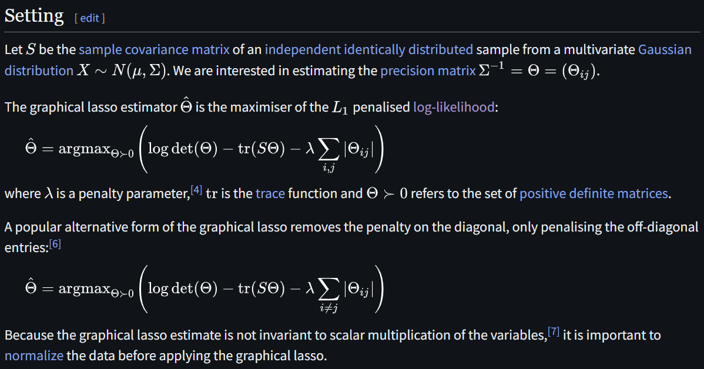
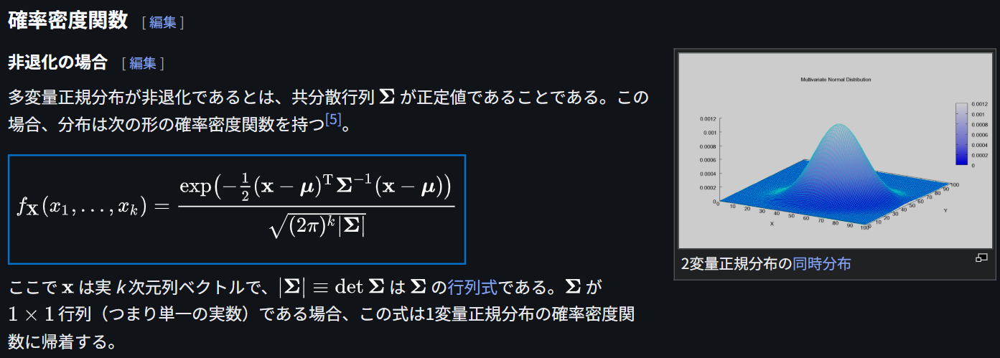

# Graphical Lasso

文献:

https://en.wikipedia.org/wiki/Graphical_lasso

https://hastie.su.domains/Papers/graph.pdf

解説:

Graphical Lassoという名前であるが、グラフ要素は手法自体には出てこない。本質的にやっていることは多変量正規分布の逆共分散行列(精度行列、precision matrixとも)を、$L_1$ 正則化付きの最尤推定によって疎に推定すること。

目的関数は、多変量正規分布の負の対数尤度に $L_1$ 正則化項を加えることで得られる。これで疎性が出てくる。通常の Lasso は回帰係数を疎にするのに対し、Graphical Lasso は精度行列を疎にして条件付き独立構造を推定している。

共分散行列が正定値の多変量正規分布では、精度行列の $(i, j)$ 成分がゼロであること（$i \neq j$）と、変数 $X_i$ と $X_j$ が残りの全ての変数を条件として独立であることが同値になる。
その為、変数を頂点とし、推定した精度行列の非ゼロの非対角成分に対応する辺を結んだ無向グラフは、推定されたガウス分布の条件付き依存構造を表す。
