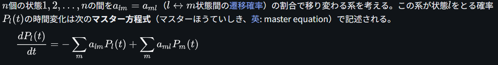
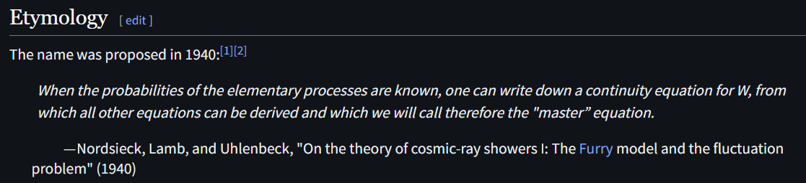

# Master Equation

文献:

https://ja.wikipedia.org/wiki/%E3%83%9E%E3%82%B9%E3%82%BF%E3%83%BC%E6%96%B9%E7%A8%8B%E5%BC%8F

https://en.wikipedia.org/wiki/Master_equation

https://arxiv.org/abs/2609.16524

解説:

どちらかというと制御の文脈。
連続版のマルコフ連鎖を記述していると捉えられる。
