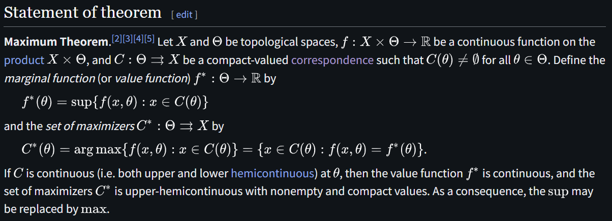
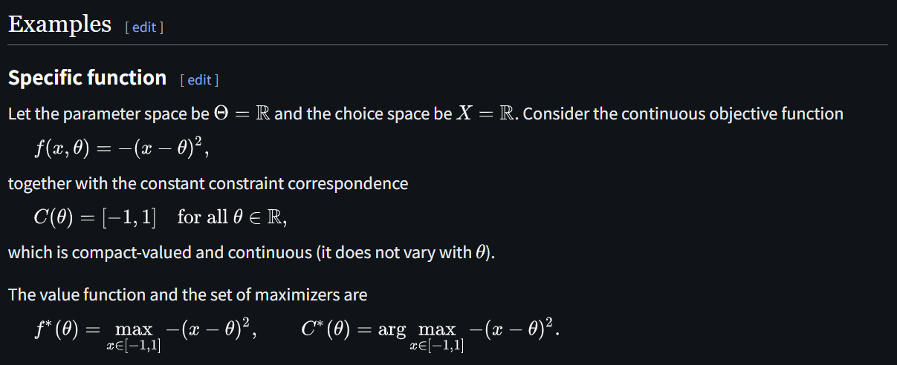
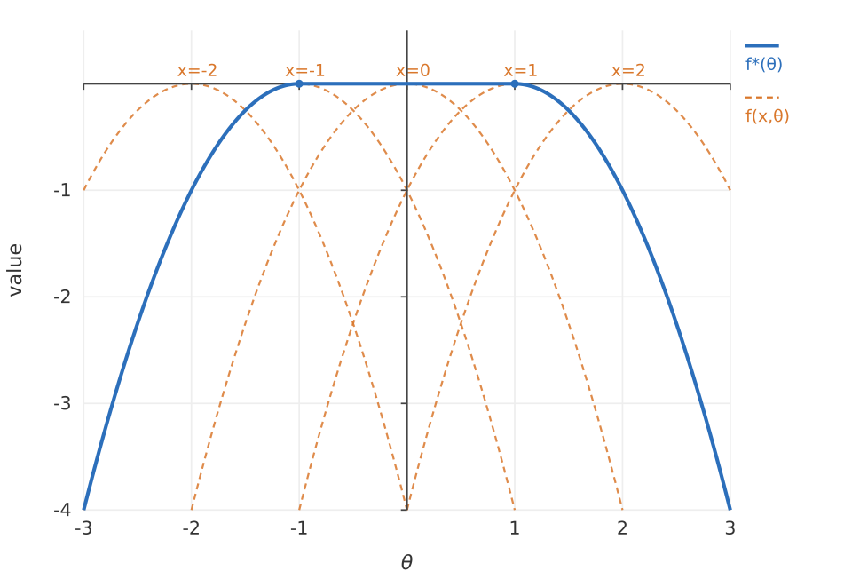
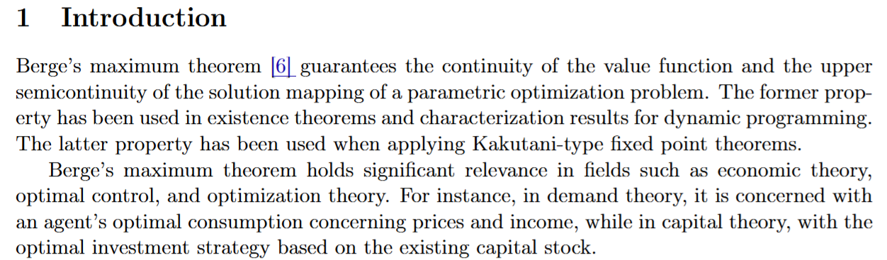

# Maximum Theorem

文献:

https://en.wikipedia.org/wiki/Maximum_theorem

(この $f^*(\theta)$ が連続というのが主張の一つ)

https://arxiv.org/abs/2608.25789

<!--  -->

> Berge’s maximum theorem holds significant relevance in fields such as economic theory, optimal control, and optimization theory. For instance, in demand theory, it is concerned with an agent’s optimal consumption concerning prices and income, while in capital theory, with the optimal investment strategy based on the existing capital stock.

(本論文のSection 1より引用)

解説:

(Berge の) Maximum Theoremは、パラメータに依存する最適化問題について、最適値関数の連続性と最適解写像（各パラメータに最適解の集合を対応させる集合値写像）の上半連続性を保証する定理。
典型的には、目的関数が連続で、実行可能集合を与える対応が非空・コンパクト値かつ連続であることを仮定する。

各パラメータで最適解が一意なら解写像の連続性も得られるが、一般には連続な最適解の選択が存在するとは限らない。
