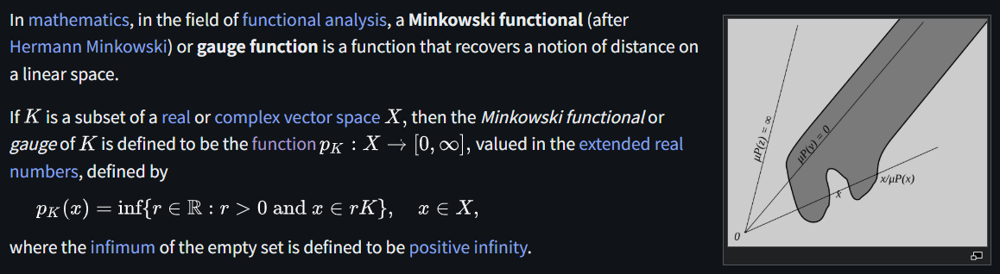

# Minkowski Functional

文献:

https://en.wikipedia.org/wiki/Minkowski_functional

解説:

Gauge Functionとも。
$p_K(x) = \inf\{ r \in \mathbb{R} : r > 0 \text{ and } x \in r K \}$ が定義の本体。
$rK$ というのがややトリッキーだが、$\frac{1}{r} x \in K$ と考えると、何倍伸ばしても同じ集合に入っているか、という数の逆数と捉えられる。
[seminorm](https://en.wikipedia.org/wiki/Seminorm)と密接な関係。
