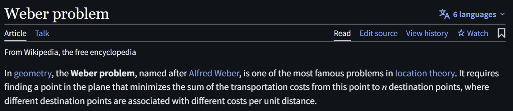
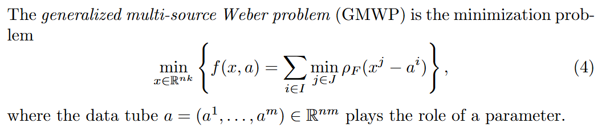

# Weber Problem

文献:

https://en.wikipedia.org/wiki/Weber_problem

https://arxiv.org/abs/2609.16703

解説:

Fermet--Weber Problemとも。
[opt100](https://scmopt.github.io/opt100/39Weber.html)でも取り上げられており、「平面上のどこにでも施設を配置できるタイプの立地問題は，Weber問題(Weber problem)とよばれる．」とある。

これの一般化などが研究されているようである。
